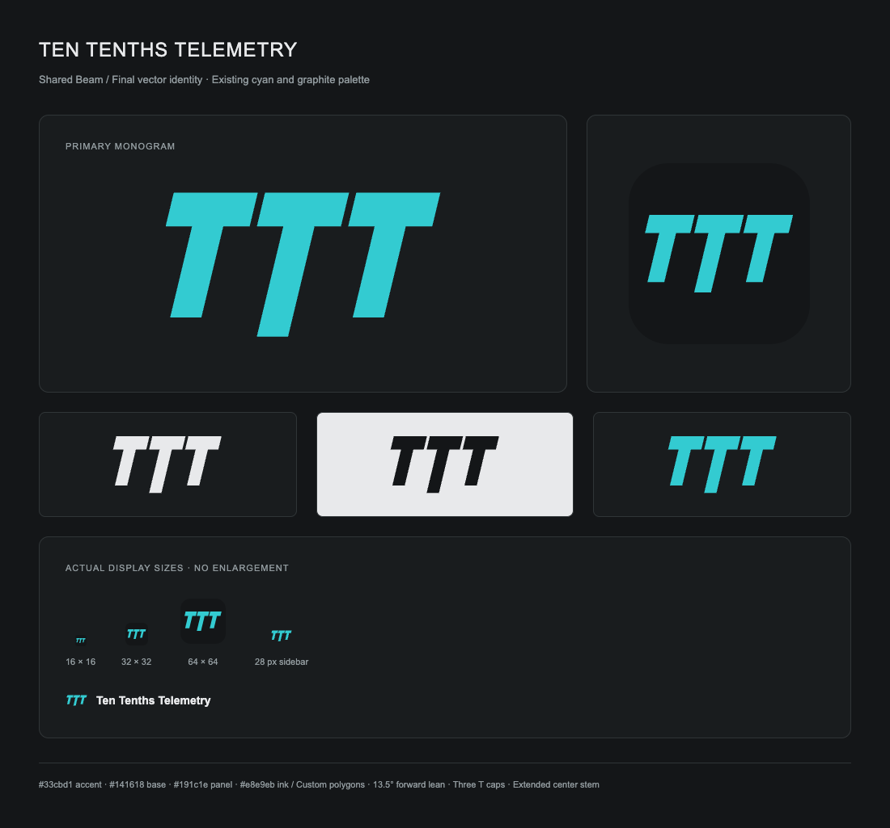

# Ten Tenths Telemetry identity

The custom **Shared Beam** monogram gives each T a full cap and a robust stem. Three aligned caps form one visual rail, separated by deliberate diagonal seams. A 13.5° forward lean suggests motion without making the letters look like sevens. The center stem extends eight design units below the outer stems, providing a distinctive cadence and a stable optical center. There are no fonts, embedded bitmaps, traced raster contours, strokes, masks, filters, or gradients in the production mark.

## Exploration and refinement

The built-in ImageGen tool produced [three distinct directions](ttt-exploration.png), followed by [one targeted refinement](ttt-refinement.png). These raster sheets are design research, not production assets. The selected direction was rebuilt as three editable vector polygons with exact spacing and a much more restrained lean.

The following five-point scores record the design judgement used to select a direction. They are comparative design assessments, not measured user-study results.

| Concept | Originality | Balance | Three-T readability | Small-size performance | Decision |
| --- | --- | --- | --- | --- | --- |
| Shared Beam | 4 | 4 | 3 | 5 | Select; refine the extreme lean and restore both cap overhangs |
| Nested Apex | 4 | 4 | 3 | 2 | Reject; intricate central cuts and ambiguous secondary letterforms |
| Triad | 3 | 4 | 2 | 3 | Reject; rotational construction resembles a generic recycling emblem |

Refinement replaced the first concept's extreme italic with a consistent 0.24 horizontal-to-vertical slope. Each 35-unit cap has a 13-unit stem and equal 11-unit overhangs. The beam seams remain three units wide. Outer stems end at y=64; the center ends at y=72. All joins are polygon corners, so there are no overlapping strokes or accidental intersections.

Final inspection used the production SVG, PNG and decoded ICNS files. [The self-contained preview](preview.html) shows PNGs at actual CSS sizes of 16, 32 and 64 pixels, plus a 28-pixel sidebar mark. The three stems remain distinguishable at 16 pixels; at that size the seams serve as optical separation rather than fine detail. No clipping or distortion was observed. Larger application and monochrome samples were inspected as well.

## Existing theme snapshot

These are the original `src/styles.css` root tokens, recorded before asset work. No theme file was changed by the asset work.

| Token | Value |
| --- | --- |
| `--bg` | `#141618` |
| `--panel` | `#191c1e` |
| `--raised` | `#222629` |
| `--border` | `#303537` |
| `--ink` | `#e8e9eb` |
| `--muted` | `#929b9f` |
| `--grid` | `#2b3033` |
| `--cyan` | `#33cbd1` |
| `--amber` | `#efb35b` |
| `--soft` | `#1c292b` |

Production logo colors are exclusively the existing cyan, ink and base tokens. The icon's background is `--bg`, with transparent padding outside its rounded square. The favicon fills its square more fully for browser-tab visibility. Typography remains an application concern; no new brand font is introduced.

## Editable sources and generated assets

- `public/brand/ttt-primary.svg`: primary cyan monogram.
- `public/brand/ttt-compact.svg`: same geometry with tighter optical bounds for navigation.
- `public/brand/ttt-light.svg`: existing ink color on dark surfaces.
- `public/brand/ttt-dark.svg`: existing base color on light surfaces.
- `public/brand/favicon.svg`: browser-tab icon.
- `src-tauri/icons/ttt.svg`: canonical 1024-unit application-icon vector, with 64-unit outer safe area and 198-unit corner radii.
- `src-tauri/icons/16x16.png`, `32x32.png`, `64x64.png`, `128x128.png`, `128x128@2x.png` (256), `icon.png` (512), and `1024x1024.png`: generated desktop PNG resources.
- `src-tauri/icons/icon.ico`: Windows multi-resolution icon, containing 16, 24, 32, 48, 64 and 256-pixel frames.
- `src-tauri/icons/icon.icns`: macOS multi-resolution icon, containing Tauri-generated 1× and 2× representations through 1024 pixels.
- `scripts/generate-brand-assets.mjs`: shared editable polygon geometry and reproducible vector/icon export.

Run `node scripts/generate-brand-assets.mjs` from the repository root to regenerate all production assets using the installed Tauri CLI. The CLI generates in a temporary directory; the script copies only the desktop resources used by this project. Its temporary mobile/store files are removed. The obsolete, unreferenced `src-tauri/icons/apex.svg` was removed.

Tauri's documentation was checked through Context7 for SVG-source icon generation and desktop bundle requirements. The installed CLI generated the ICO/ICNS files successfully; `sips` confirmed every PNG dimension and decoded the ICNS for visual inspection. This validates icon resources, not a Windows installer build.

## ImageGen prompts

Built-in tool mode was used without an API key or a custom image-generation runner. The comparison and refinement files are saved beside this document; neither is embedded into the final SVG.

**Exploration:** Create a precise flat visual comparison sheet with three original distinct custom TTT monograms for Ten Tenths Telemetry, premium motorsport engineering software. Entire sheet dark #141618, marks cyan #33cbd1 only, restrained labels in #e8e9eb. Three evenly spaced columns with large mark and thumbnail. Shared Beam: unified horizontal bar, three subtly forward slanted stems, staggered bar breaks, each T identifiable. Nested Apex: three interlocking T shapes nested into compact angular shield silhouette without a border. Triad: three custom T forms joined into a rotational triangular emblem. Mathematically balanced stroke weight and negative space; no gradients, shadows, checkers, copied trademarks, ordinary font TTT, or mockups.

**Refinement:** Refine only Shared Beam into a premium TTT precision monogram. Large mark, sidebar sample and dark rounded-square application icon. Strict #33cbd1 on #141618. Reduce extreme italic to a subtle forward lean so each of the three letters reads as T, with genuine left and right cap overhangs. Use precise diagonal incision seams between caps, robust consistent weights and open channels. Extend the center stem modestly; keep outer stems equal. No ordinary font, wordmarks inside the icon, gradients, glow, or texture. Rebuild final production geometry as clean vectors.
